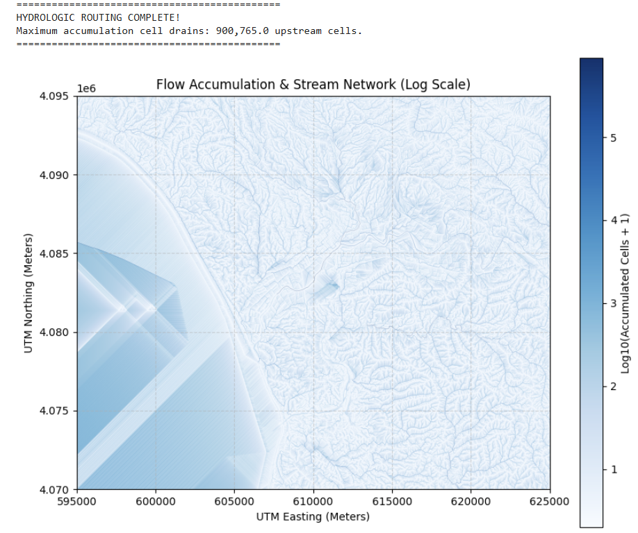
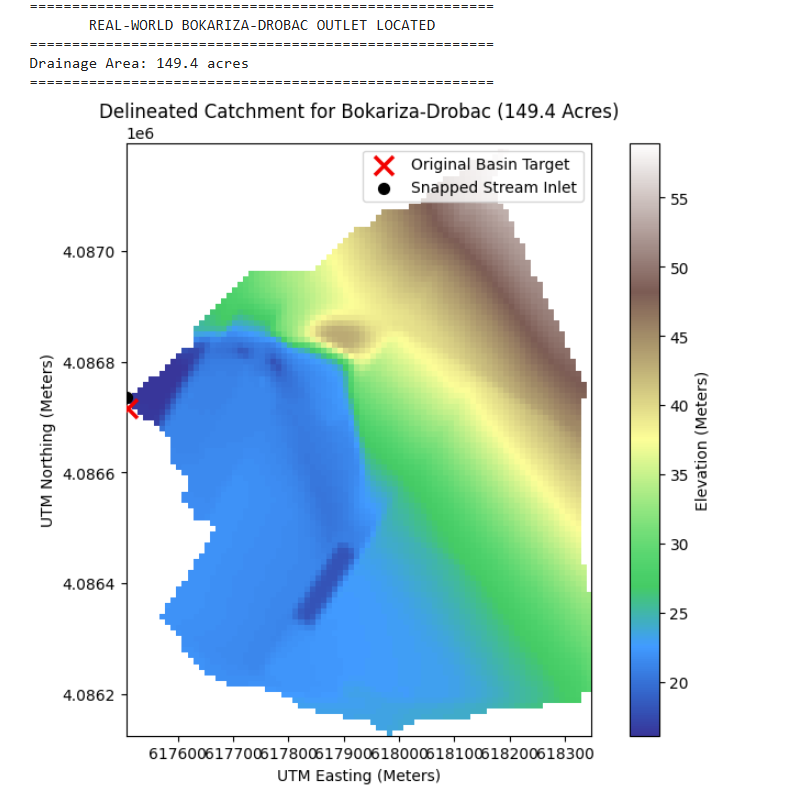
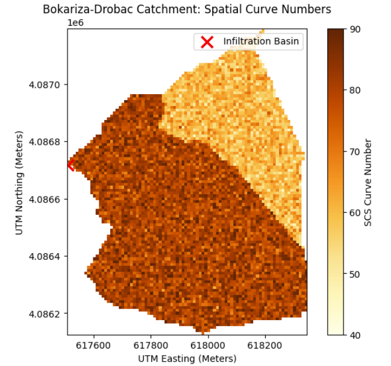

# Agricultural Watershed Hydrology & Runoff Modeling (`pysheds`)

An open-source Python geospatial pipeline utilizing **USGS 3DEP Digital Elevation Models (DEMs)**, `pysheds`, `rioxarray`, and the **USDA-NRCS Curve Number (SCS-CN)** method to automate catchment delineation, surface runoff modeling, and stormwater retention evaluation for agricultural compliance and groundwater recharge.

---

## 🎯 Purpose & Regulatory Relevance

This workflow bridges high-resolution spatial data and practical water resource management:
* **California Ag Order / Track 2 Compliance:** Automates spatial hydrologic routing and volumetric stormwater calculations required for **Management Practice Plans (MPPs)** under Regional Water Board Irrigated Lands Regulatory Programs (ILRP).
* **Managed Aquifer Recharge (MAR) / ReNeM:** Evaluates hillslope runoff yield and capture efficiency to model landowner pumping fee rebates under Recharge Net Metering programs.

---

## 🗺️ Visual Model Outputs & Maps

### 1. D8 Flow Accumulation & Stream Network (Log Scale)
Computes flow direction across the regional DEM and applies a logarithmic scale to highlight micro-channels and main drainage networks.

### 2. Automated Catchment Delineation (~150-Acre Bokariza-Drobac Basin)
Snaps outfall coordinates to active stream channels and delineates the upstream contributing hillslope catchment.

### 3. Spatial Curve Number (SCS-CN) Raster Distribution
Maps dynamic Curve Number values across elevation zones to simulate surface runoff potential and infiltration behavior.

---

## 🔬 Hydrologic & Technical Workflow

1. **DEM Conditioning & Reprojection:**
   * Ingests USGS 1/3 arc-second DEMs, reprojects to local metric coordinate systems (**UTM Zone 10N / EPSG:26910**), and standardizes pixel resolution to 10 meters.
2. **Hydrologic Routing (`pysheds`):**
   * Pre-processes terrain by resolving single-cell pits, multi-cell depressions, and flat topography to enforce continuous downslope gradients.
   * Computes D8 flow direction and log-scaled flow accumulation stream networks.
3. **Automated Catchment Delineation:**
   * Snaps target outfall coordinates to active drainage channels and delineates contributing upstream hillslopes.
4. **SCS-CN Runoff Modeling:**
   * Generates spatial Curve Number (CN) rasters based on elevation partitions, crop covers, and soil hydrologic groups.
   * Quantifies volumetric runoff (Acre-Feet / Cubic Feet) for single design storms (e.g., 2.5" design storm) and annual water-year totals (22" median precipitation).

---

## 📊 Data Sourcing & Preparation

* **Base Elevation Data:** Downloaded as raw USGS 1/3 arc-second DEM tiles from the USGS 3DEP National Map downloader.
* **Spatial Processing (QGIS / GDAL):**
  1. Warped and reprojected from geographic coordinates (EPSG:4269) to local metric grid **UTM Zone 10N (EPSG:26910)**.
  2. Standardized pixel resolution to 10 meters.
  3. Assigned NoData values to empty edge pixels and saved as `pajaro_valley_utm10n.tif`.
* **Repository Data Note:** Due to GitHub file size restrictions (the base regional DEM is ~401 MB), raw base GeoTIFFs are kept locally. The Jupyter notebook executes dynamic spatial cropping (`pajaro_only_dem.tif`) during execution to maintain a lightweight footprint.

---

## 🛠️ Tech Stack & Dependencies

* **Language:** Python 3.x
* **Core Geospatial Libraries:** `pysheds`, `rioxarray`, `rasterio`, `pyproj`, `numpy`, `pandas`, `matplotlib`
* **GIS Interoperability:** QGIS, Google Earth Engine, USGS 3DEP Elevation Data

---

## 📁 Repository Files

* `Pajaro_pysheds2.ipynb` — Primary Jupyter Notebook containing the end-to-end Python script.
* `Pajaro_pysheds_pdf2.pdf` — Full technical project report and executed documentation.
* `flow_routing.png`, `Watershed_delineation.png`, `NRCS_Curve_Number.png` — Rendered map visualizations.
* `README.md` — Repository documentation and technical workflow summary.

---

## 👤 Author & Contact

**Gregory J. Wilson, M.S.**  
*Wilson Hydrologic Consulting*  
Specializing in agricultural water quality compliance, hydrologic modeling, and GIS spatial analytics.

## 🤖 Development & AI Assistance Note

Portions of this repository were developed with the assistance of AI coding and workflow tools (including Gemini and Python automation scripts) to accelerate code scaffolding, data wrangling logic, and README drafting. 

* **Human Verification:** All spatial routines, algorithmic implementations, and calculations (such as SCS-CN runoff equations and GIS flow routing) have been independently reviewed, tested, and validated by the author.
* **Responsibility:** The final architecture, data integrity, and technical accuracy remain solely the responsibility of the project author.
